# DataStrap CI/CD

A complete **Jenkins + SonarQube + Docker** CI/CD pipeline built around DataStrap, a Fitbit-style health dashboard
(Python backend, JavaScript frontend, Node mobile app and token server). This repository is a copy of
<https://github.com/mokshlakhani/DataStrap> plus the automation. It uses **only the built-in demo data**: no Google sign-in, no personal files.
The original app's own README is kept in [docs/ORIGINAL_APP_README.md](docs/ORIGINAL_APP_README.md).

Every push is automatically linted, tested, quality-checked, packaged into a Docker image, security-scanned, deployed to staging, and (after a human click) to production, with health checks and automatic rollback.

## Architecture

```mermaid
flowchart LR
    Dev([Developer]) -- push --> GH[(GitHub)] -- webhook / polling --> J[Jenkins]
    J --> T[Lint + Tests] --> SQ[SonarQube + Quality Gate] --> DB[Docker build] --> TR[Trivy scan]
    TR --> ST[Deploy staging :8081] --> AP{{Manual approval}} --> PR[Deploy prod :8080]
    PR --> HC[Health check + smoke test]
    HC -- unhealthy --> RB[Auto-rollback]
```


More detail: [docs/ARCHITECTURE.md](docs/ARCHITECTURE.md).

## Quick start

Needs Docker (with Compose), git and make. Details and screenshots-to-expect: [docs/SETUP.md](docs/SETUP.md).

```bash
git clone https://github.com/mokshlakhani/datastrap-cicd.git
cd datastrap-cicd
make up        # starts Jenkins (http://localhost:8090) and SonarQube (http://localhost:9000)
```
Then follow SETUP.md steps 5-14 once (unlock Jenkins, add the SonarQube token, create the job).

Other commands: `make setup` (install everything locally), `make lint`, `make test`, `make build`, `make down`, `make demo-fail`.

**SonarQube on Linux** needs `sudo sysctl -w vm.max_map_count=262144`. **Docker Desktop**: usually already fine; if SonarQube restarts in a loop run
`docker run --rm --privileged --pid=host alpine nsenter -t 1 -m -u -n -i sysctl -w vm.max_map_count=262144` and give Docker 4 GB RAM.

## Pipeline stages

| # | Stage | Tool | Why |
|---|---|---|---|
| 1 | Checkout | Git | Get the code of the pushed branch and work out the image tag (`BUILD_NUMBER-gitSHA`) |
| 2 | Install deps | venv, pip, `npm ci` (3 in parallel) | Reproducible installs from pinned files |
| 3 | Lint | flake8 | Catch code mistakes before running anything |
| 4 | Test | pytest + pytest-cov, `npm test`, JUnit | Prove the code works; publish results and coverage |
| 5 | SonarQube analysis | sonar-scanner | Bugs, vulnerabilities, smells, duplication, coverage |
| 6 | Quality Gate | SonarQube webhook | Abort the pipeline if quality rules fail |
| 7 | Docker build | Docker | Package the app (non-root user, health check) |
| 8 | Security scan | Trivy | Fail on CRITICAL, report HIGH |
| 9 | Deploy: staging | Docker + `ci/deploy.sh` | Auto-deploy on `main`, port 8081, rollback if unhealthy |
| 10 | Approve prod | Jenkins `input` | A human decides about production |
| 11 | Deploy: prod | Docker + `ci/deploy.sh` | Port 8080, wait for health, auto-rollback |
| 12 | Smoke test | curl (`ci/smoke_test.sh`) | Confirm the running app really answers |

Triggers: GitHub webhook, with `pollSCM` every ~5 minutes as fallback. `post` actions: archive reports, clean workspace, success/failure message.
An optional, lighter second CI (lint + tests only) is in `.github/workflows/ci.yml` for comparing with Jenkins.

## Project map

| Path | What it is |
|---|---|
| `Jenkinsfile` | The pipeline, every line commented |
| `Dockerfile`, `.dockerignore` | App image |
| `docker/docker-compose.yml` | Jenkins + SonarQube + Postgres (pinned versions); `docker/jenkins/` builds the Jenkins image |
| `ci/` | `deploy.sh` (deploy + rollback), `smoke_test.sh`, `to_junit.py` |
| `tests/` | pytest suite (sleep score, body age, demo data, web server) |
| `sonar-project.properties`, `.flake8`, `.coveragerc` | Tool settings |
| `docs/` | SETUP, ARCHITECTURE, DEMO_SCRIPT, VIVA_CHEATSHEET |

## Screenshots checklist (for the lab report)

1. `docker ps` showing `jenkins`, `sonarqube`, `sonar-db`
2. Jenkins dashboard with the plugins list (Manage Jenkins -> Plugins -> Installed)
3. Credentials page showing `sonar-token` (the token itself hidden)
4. Jenkins -> System: SonarQube server configuration
5. SonarQube webhook page
6. Pipeline job configuration (SCM, trigger)
7. Stage View of a fully green build, including the "Approve prod" prompt
8. Console output of the Test stage (pytest passing)
9. Test Result page (JUnit)
10. SonarQube project overview with Quality Gate **Passed** (and coverage)
11. Trivy report (artifact `trivy-high.txt`) 
12. `docker ps` showing `datastrap-staging` and `datastrap-prod` as `(healthy)`
13. The app in the browser on :8080
14. Stage View of the **failed** `demo-fail` build stopping at Test
15. GitHub webhook page with a green tick (and a build started by a push)
16. Architecture diagram (render of the Mermaid chart)

## Changes from the original

The application's behaviour is unchanged. The differences are:

1. **`serve.py`**: the bind address now comes from a `HOST` environment variable, default `127.0.0.1` (same as before). The Docker image sets `HOST=0.0.0.0` so the port can be published. Three added lines.
2. **`mobile/package.json` + `mobile/test/run_ci.mjs`**: new script `npm run test:ci`. The original `npm test` is untouched, but it compares against *your real Fitbit data* (`api_data/`), which CI must not have, so `test:ci` runs only the synthetic-data part.
3. **`.github/workflows/web-app.yml` (GitHub Pages deploy) removed**: it belongs to the original site and would fail in this repository. The optional `ci.yml` replaces it.
4. **`.gitignore`**: extra entries for reports, coverage and `docker/.env`.
5. **`.flake8`** ignores cosmetic spacing warnings in the original code and two real-but-harmless warnings (unused import in `api_ingest.py`, redefinition in `google_health_sync.py`), so the app code did not need editing.
6. **Not copied** (personal data): `google_tokens.json`, `credentials.json`, `oauth_client.json`, `profile.json`, `api_data/`, `dashboard_data.json`, `takeout/`, `app_sleep_scores.csv`, `.venv/`, `logs/` (none were in the public repo anyway).

## Troubleshooting

| Problem | Fix |
|---|---|
| SonarQube restarts / "max virtual memory areas too low" | Set `vm.max_map_count` (see Quick start) |
| Quality Gate stage waits 10 minutes then times out | The SonarQube webhook to `http://jenkins:8080/sonarqube-webhook/` is missing (SETUP step 11) |
| `withSonarQubeEnv` error "No such server" | The server name in Jenkins must be exactly `sonarqube` |
| `permission denied ... docker.sock` | Compose runs Jenkins as root for this reason; on Linux make sure you did not remove `user: root` |
| `port is already allocated` on 8080/8081/8090/9000 | Something else uses it: stop that program (`lsof -i :8080`) |
| Deployed app answers 403 | The app only accepts the Host `localhost:<port>`, and the published port must equal the container port (`-p 8080:8080`) |
| Trivy fails with CRITICAL findings | Rebuild so the Dockerfile pulls the newest OS patches; if nothing is fixable it is ignored (`--ignore-unfixed`) |
| Webhook does nothing | ngrok restarted? Update the webhook URL. Polling still triggers within ~5 minutes |
| Mobile `npm test` fails with "no such file .venv" | That original test needs `make setup` plus real data; the pipeline uses `npm run test:ci` instead |
