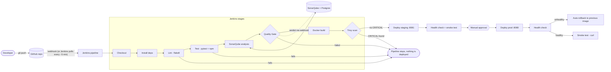

# Architecture

## The flow

## What runs where

| Piece | Where it runs | Port |
|---|---|---|
| Jenkins (+ Docker CLI, Python, Node, Sonar scanner) | container `jenkins` | 8090 |
| SonarQube Community | container `sonarqube` | 9000 |
| Postgres (SonarQube's database) | container `sonar-db` | internal |
| Trivy | short-lived container started by the pipeline | - |
| App, staging | container `datastrap-staging` (started by pipeline) | 8081 |
| App, prod | container `datastrap-prod` (started by pipeline) | 8080 |

All of them share one Docker network called `datastrap-ci`, so they can reach each other by name
(for example Jenkins calls `http://sonarqube:9000`, and SonarQube calls back `http://jenkins:8080/sonarqube-webhook/`).

## How Jenkins can start containers

Jenkins is itself a container, but we mount your computer's Docker socket (`/var/run/docker.sock`) into it.
So when the pipeline runs `docker build` or `docker run`, the **host's** Docker does the work, and the
new containers appear next to Jenkins ("sibling containers"). This is the simplest set-up for a lab.
Trade-off: anything that can use the socket controls Docker on the host, so never expose this Jenkins to the internet.

## Design decisions

* **Deploy only from `main`.** Other branches (like `demo-fail`) run everything up to Trivy and then skip the deploy stages.
* **Staging first, prod after a human click.** Staging deploys on its own; prod waits at an `input` step.
* **Rollback = start the previous image again.** Simple and easy to explain; there is a few seconds of downtime
  (a real blue-green set-up would avoid that, see the viva cheat sheet).
* **Trivy blocks on CRITICAL only**, and only on problems that already have a fix (`--ignore-unfixed`); HIGH is reported.
* **The app image has no pip packages.** The dashboard server uses only Python's standard library, so the image is small.
* **Demo data only.** No Google sign-in, tokens or personal files exist anywhere in the pipeline.
